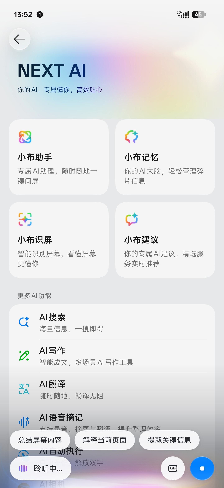
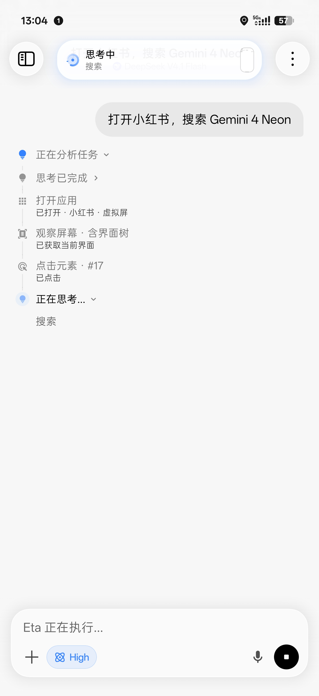
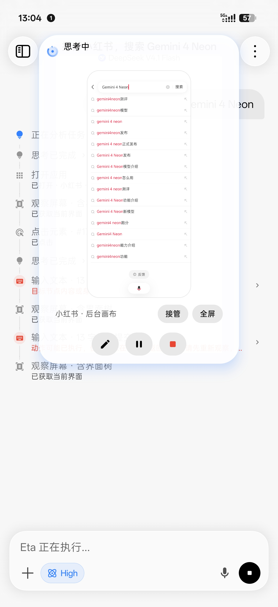
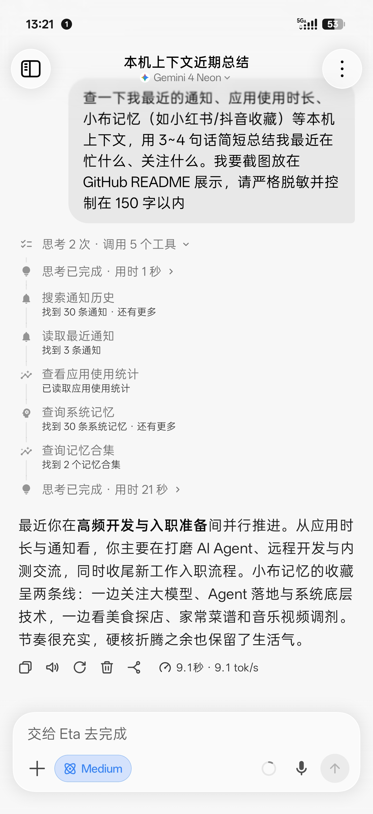
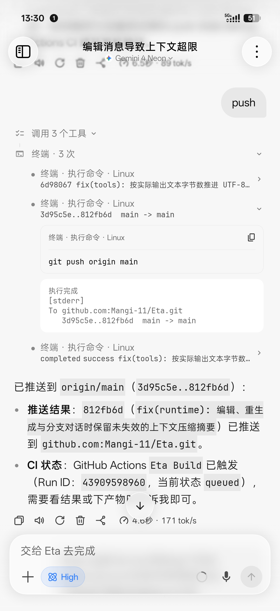
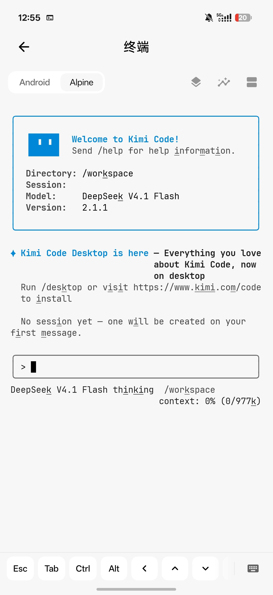
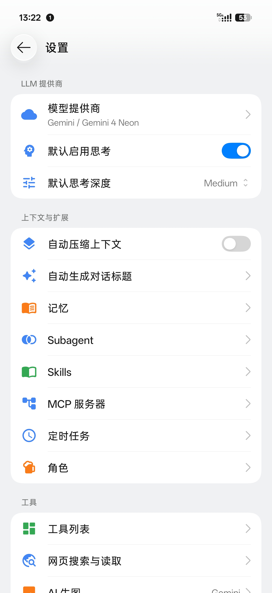
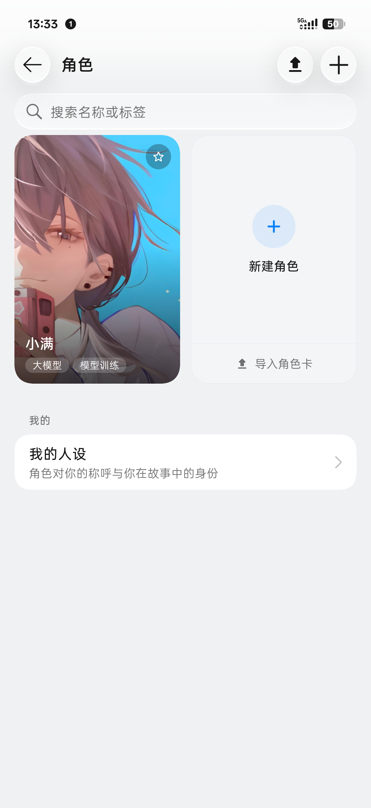

# EtaX

**简体中文** | [English](README_EN.md)

> 本仓库为 [icexxl/EtaX](https://github.com/icexxl/EtaX)（`applicationId: io.github.icexxl.etax`），基于上游开源项目 [Mangi-11/Eta](https://github.com/Mangi-11/Eta) 深度定制维护，可与上游版本共存。在保留上游完整能力与署名的基础上，新增 **OpenClaw 远端渠道（SSE + FCM 推送唤醒）**、**免 Root 后台虚拟屏（Stellar）** 与模块化架构。上游仅作只读基线参考，本分支不向上游提交 PR、Issue 或补丁。

**大模型时代的 Android 系统级 AI 助手与移动设备 Agent。**

**EtaX** 是面向手机与移动设备设计的 AI Agent，结合了 [Codex](https://openai.com/codex/) 这类 Coding Agent 的自主规划与执行能力，以及[豆包手机助手](https://o.doubao.com/)的跨应用 GUI 操作体验。

## EtaX 专属增强（相对上游 Eta）

- **OpenClaw 远端 Agent 渠道（`:openclaw-core`）**：
  - 原生接入自建 OpenClaw Gateway，侧栏直达会话列表与三段式对话顶栏，支持流式思考过程与工具调用实时渲染、底部平滑跟随滚动。
  - 传输层支持单连接 **SSE** 实时事件流、`ETag`/`304` 增量缓存、自动降级长轮询以及系统网络切换监听（`OpenClawNetworkMonitor`）秒级重连。
  - 支持 **Firebase Cloud Messaging（FCM）后台推送唤醒**与「后台休眠省电」开关：退后台或息屏断开长连接后仍可由服务端高优先级推送秒级唤醒通知（本地自行构建时放入 `app/google-services.json` 即可启用，缺失时自动跳过插件编译）。
- **免 Root 后台虚拟屏（`:vscreen-core` + `:stellar-api`）**：
  - 接入 **Stellar**（Shizuku 兼容特权服务）托管 `shell` 权限用户服务，**无需 Root** 即可创建后台虚拟屏静默执行跨应用 GUI 任务，支持顶部胶囊微缩预览与一键移交主屏。
  - 系统提示词动态感知免 Root / Root / LSPosed 虚拟屏可用状态与当前权限边界，避免模型幻觉调用不可用工具。
- **模块化架构与品牌统一**：
  - 核心源码保留上游 `io.github.mangi.eta` 命名空间以降低上游同步冲突，将 OpenClaw 与免 Root 虚拟屏解耦为独立子模块；应用 ID（`io.github.icexxl.etax`）、默认提示词（支持旧配置无损迁移）与全端文案统一为 **EtaX**。

## 项目概览

EtaX 对标手机厂商预装的一方系统助手，围绕 Android 系统服务、厂商 ROM 与个人数据做了深度适配，**目标是做出大模型时代真正的 AI 手机体验**：

- **全方位的手机个人上下文**：直连系统与厂商底层数据及**小布记忆**（含一键闪记或收藏的小红书、抖音、B站图文与视频摘要），按需检索通知、短信验证码、通话、相册（文字与画面搜图）、录音摘要、便签、健康、剪贴板、聊天图片，以及账单收支、行程与外卖快递订单等等。
- **系统与一方应用原生操作**：直接调用 Android API 与一方应用原生接口读写日历日程、管理闹钟与计时器、操作便签并控制各类系统开关；跨应用任务可在后台受信任**虚拟屏**静默执行（支持免 Root Stellar、Root 或 LSPosed）。
- **原生数字助理与系统入口**：将系统默认数字助理切换为 EtaX 后，长按电源键即可带屏直唤，支持 Android 16+ 实时活动（Live Updates / 流体云），并在适配 ROM 上支持电源键路由（唤起 EtaX 或 Gemini）与解锁 Google 一圈即搜。
- **完整的 Agent Runtime 与扩展**：独立实现 Agent Runtime 与 Agent Loop，内置并发 Subagent、定时任务、移动端 PTY 终端与 Linux、AI 生图、长期记忆、Skills、MCP、酒馆角色陪伴与 **OpenClaw 远端渠道**。

支持自备 **API Key（BYOK）** 及 **Codex（ChatGPT）/ Grok 订阅登录**，模型由你自由选择。支持 **Android 14+** 设备，不限品牌，基础功能免 Root；**Stellar 特权服务**可免 Root 解锁后台虚拟屏，Root 与 LSPosed 可进一步解锁深层个人上下文与系统入口增强。

[下载 APK](https://github.com/icexxl/EtaX/releases) · [专属增强](#etax-专属增强相对上游-eta) · [使用场景](#你可以直接对-etax-说) · [核心能力](#核心能力) · [权限分层](#权限与设备支持) · [快速开始](#快速开始) · [为什么做 Eta](docs/WHY_ETA.md)

## 你可以直接对 EtaX 说

- **电源键看屏问答与当前页代办** — *长按电源键直接针对当前屏幕提问，或让 EtaX 原地帮你填表单信息、写外卖好评并提交等。*
- **连接 OpenClaw 远端 Agent** — *在手机端直接与部署在家里或服务器上的 OpenClaw 实时对话，后台息屏也能通过 FCM 推送收到长任务回复。*
- **真机玩机与模块制作** — *“检查我这台手机当前的系统环境和配置，帮我写一个 Magisk 模块，打包好直接刷入。”*
- **手机疑难杂症与排错分析** — *遇到异常耗电、通知不响、权限冲突或 App 闪退等手机疑难杂症，直接让 EtaX 查系统状态、抓最近的 logcat 日志或分析安装包，快速定位并处理。*
- **手机上自由 Vibe Coding** — *随时随地在完整 Linux 环境与 Android 自身 Shell 里写代码、建项目、拉仓库、跑测试，或在触控 PTY 终端里直接运行 Claude Code、Codex。*
- **打通小布记忆与个人数据** — *“翻一下我小布记忆里一键闪记或收藏的小红书攻略、抖音视频摘要、账单和机票订单，整理成下周出行计划写进日历，再定好出发当天的闹钟。”*
- **后台静默跨应用办事（免 Root 可用）** — *“去机票软件里帮我找到换座位并选个靠窗位置，我在看视频别打扰我，到确认页再交给我”。*
- **定时值守与多路调研** — *“每天早上 8 点整理昨天的通知和今日日程，有重要变化再提醒我；或者同时开几个 Subagent 并行调研资料。”*
- **情感陪伴与角色互动** — *创建专属角色或导入酒馆（SillyTavern）角色卡，在世界书与独立剧情记忆中日常陪伴；结合手机里全方位的个人上下文，角色更懂你的日常，也能直接帮你查日程、定闹钟、操作手机。*

## 界面预览

| 原生电源键全局唤醒 | 后台虚拟屏运行 | 虚拟屏实时预览与接管 |
| :---: | :---: | :---: |
|  |  |  |

| 全方位个人上下文 | 手机端 Vibe Coding | 触控 PTY 终端 |
| :---: | :---: | :---: |
|  |  |  |

| 设置 | 接管小布（历史演示） | 角色与情感陪伴 |
| :---: | :---: | :---: |
|  |  |  |

## 核心能力

### 系统级助手与个人生态

- **全方位个人上下文**：按需检索通知历史、日历、位置、短信验证码、通话与通讯录、相册（文字 OCR 与画面搜图）、录音、剪贴板、健康汇总与聊天图片；ColorOS 上更直接打通**小布记忆**与 **ColorOS 聚合搜索服务（DMP）**，将平时一键闪记或收藏的小红书 / 抖音 / B站图文与视频摘要、随口记灵感、记忆合集、账单、行程、外卖快递、便签、录音摘要及收藏地点，全部开放给你自选的大模型调用。
- **系统与一方原生操作**：直接调用 Android 与一方应用原生接口读写日历、管理闹钟与计时器、操作便签，并控制亮度、音量、勿扰、手电筒、Wi-Fi、蓝牙、热点、NFC、应用冻结等系统能力。
- **原生数字助理与系统入口**：设为系统默认数字助理即可长按电源键带屏直唤；支持 Android 16+ 实时活动（Live Updates / 流体云 / 超级岛）、聊天长按语音输入（千问 / 豆包 / MiMo / DeepSeek）与多引擎播报；适配 ROM 支持长按电源键路由（唤起 EtaX、Gemini 或系统默认助手，并自动校正默认助理）与解锁 Google 一圈即搜（手势条长按 / 双指识屏）。
- **GUI 与后台虚拟屏**：结合无障碍与原图视觉跨应用操作；支持主屏原地接管，具备 **Stellar 特权服务（免 Root）**、Root 或 LSPosed 时跨应用任务默认在后台虚拟屏静默运行，顶部胶囊内置实时微缩预览与随时接管，到达收银台或二维码页时一键移交主屏。

### 自主编排与移动工具箱

- **OpenClaw 远端渠道**：通过 SSE 实时接收远端 OpenClaw 的流式回复、推理过程与工具轨迹，配合 ETag 缓存、网络状态监听与 FCM 后台休眠推送，兼顾低延迟与低耗电。
- **并发 Subagent**：在独立上下文中同时运行多个子任务（内置 `explore`、`coder`、`plan` 及自定义模板），可单独配置轻量副模型并在聊天中实时查看步骤。
- **定时任务**：支持单次、周期与 Cron 后台自动运行，支持仅在有变化时提醒或静默归档，对话中即可让 EtaX 创建与管理。
- **移动端终端、Linux 与 Vibe Coding**：具备完整的读写文件、代码编辑、搜索与命令执行能力，搭配 Alpine / Debian 完整 Linux 环境（免 Root PRoot / Root chroot），可在手机上自由写代码、做项目；同时提供为移动触控设备打造的 PTY 控制台，可直接运行 Claude Code、Codex 等 TUI，并支持后台常驻任务与文件管理。
- **网页浏览与 AI 生图**：提供网页搜索与可随时接管的内置浏览器；原生接入 Gemini、OpenAI、xAI、豆包、通义千问、硅基流动六大渠道文生图与图生图，聊天内直接出图并归档画廊。

### 模型、扩展与交互体验

- **模型生态**：支持 OpenAI（Chat Completions / Responses）、Anthropic、Gemini（含 Google Cloud Vertex AI）协议；内置 12 家主流服务商，支持自定义服务、`models.dev` 目录导入及 **Codex（ChatGPT）/ Grok 订阅登录**。
- **情感陪伴与酒馆生态**：支持创建角色并兼容酒馆（SillyTavern）生态，支持 PNG / JSON 角色卡导入导出、用户人设、内嵌世界书、独立剧情记忆与回复原位编辑重生成；角色会话同样可结合手机个人上下文并调用工具，兼顾情感陪伴与实际办事。
- **记忆与扩展**：支持 `MEMORY.md` 长期记忆、GitHub / ZIP 安装 Skills 与 Streamable HTTP MCP 远程工具。
- **日常体验**：支持运行中排队与实时插话（Steer）、对话分支、原生 LaTeX 数学公式渲染、**Miuix / COUI** 双原生界面风格与简/繁/英三语界面。

## 权限与设备支持

- **普通设备（免 Root）**：完整对话与模型、OpenClaw 远端渠道（SSE + FCM 推送）、情感陪伴与酒馆角色卡、AI 生图、Subagent、定时任务、记忆 / Skills / MCP、网页与浏览器、普通终端与 PRoot Linux、日历 / 通知 / 位置 / 应用使用统计、主屏 GUI Agent、EtaX 原生数字助理。
- **免 Root + Stellar（特权服务）**：在普通设备能力基础上，额外解锁**后台虚拟屏**静默跨应用操作与实时预览接管。
- **Root 设备**：后台虚拟屏、系统开关与一方应用原生操作（闹钟管理 / 便签等）、应用管理、深层个人上下文（短信 / 通话 / 相册搜图 / 健康 / 聊天图片等）、Root Shell & chroot。
- **LSPosed + 适配 ROM**：后台虚拟屏、ColorOS / HyperOS 电源键路由（唤起 EtaX 或 Gemini）、小布记忆直连查询、解锁 Google 一圈即搜（手势条长按 / 双指识屏）。

完整权限与机型说明见 [设备支持与权限边界](docs/ROOTLESS_SUPPORT.md)。

## 快速开始

1. 从 [Releases](https://github.com/icexxl/EtaX/releases) 下载安装 APK（或自行执行 `./gradlew :app:assembleRelease` 构建），在「模型提供商」配置 API Key（或登录 Codex / Grok 订阅）并添加模型。
2. 打开「权限健康」页面按需授予系统与工具权限，并在系统中为 EtaX 开启自启动与后台锁定。
3. （可选，免 Root 虚拟屏）安装并启动 **Stellar** 授权 EtaX，即可开启免 Root 后台虚拟屏。
4. （可选，OpenClaw）在「设置 → OpenClaw」填写 Gateway 地址与 Token，开启 SSE 实时流与 FCM 后台休眠省电（自编译需放置自己的 `app/google-services.json`）。
5. （可选）进入「Linux 工具环境」安装发行版与常用工具；Root / LSPosed 设备可进一步在 LSPosed 管理器中激活模块、勾选对应作用域后重启手机。

> **隐私提示**：任务所需的上下文、图片与工具结果会发送至你配置的模型服务；敏感工具与 MCP 的原始结果不会写入本地聊天记录，并支持对话导出与整库备份迁移。

## 更多文档

- [为什么做 Eta](docs/WHY_ETA.md)：上游项目初衷、手机 AI 生态观察与 Agentic OS 展望
- [设备支持与权限边界](docs/ROOTLESS_SUPPORT.md)：免 Root / Root / LSPosed 能力范围与后台说明
- [技术实现](docs/TECHNICAL.md)：设备工具、个人数据检索、浏览器、终端与系统集成
- [Agent Runtime](docs/AGENT_RUNTIME.md)：Agent Loop、Provider、Steer、文件工具与断线恢复
- [语音配置](docs/VOICE.md)：在线语音识别与语音播报配置
- [角色功能](docs/CHARACTERS.md)：酒馆角色卡兼容、世界书与独立记忆
- [HyperOS 系统入口](docs/HYPEROS_SYSTEM_ENTRY.md)：HyperOS 电源键与一圈即搜适配说明
- [终端原生组件](docs/TERMINAL_NATIVE.md)：PTY 与 PRoot 原生组件构建方式

## 参考与致谢

- [Eta (Mangi-11/Eta)](https://github.com/Mangi-11/Eta)：本项目的上游开源基线，核心 Agent Runtime、系统集成与 UI 设计源自上游。
- [Pi Coding Agent](https://github.com/earendil-works/pi)：Agent Runtime 的核心参考，包括 Agent Loop、Tool Calling、steering 与 transcript 状态管理。
- [OmniBot](https://github.com/omnimind-ai/OmniBot)：Android AI Agent 方向的参考项目。
- [libxposed API](https://github.com/libxposed/api)：现代 Xposed API。
- [Miuix](https://github.com/compose-miuix-ui/miuix) 与 [COUI](https://github.com/suqi8/coui)：UI 组件库。

## 许可证

Copyright © 2026 [蛮吉 (Mangi-11)](https://github.com/Mangi-11) & [icexxl](https://github.com/icexxl) (EtaX fork)

本项目基于 GPL-3.0 开源，详情请参阅 [LICENSE](LICENSE)。
