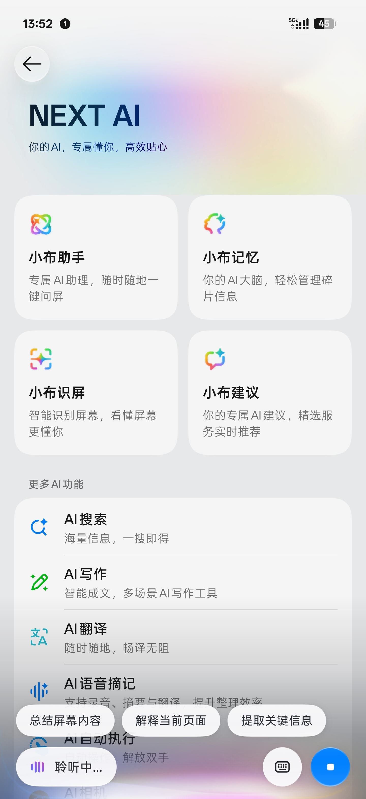
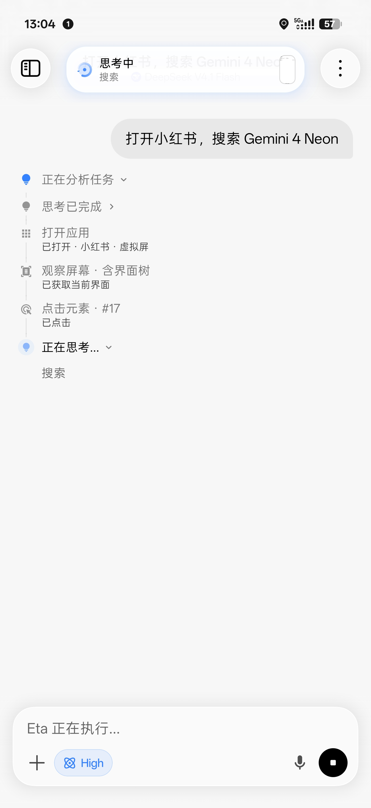
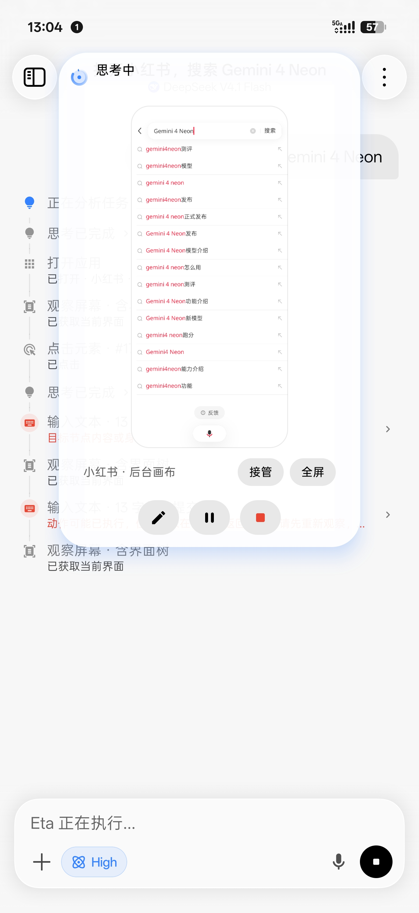
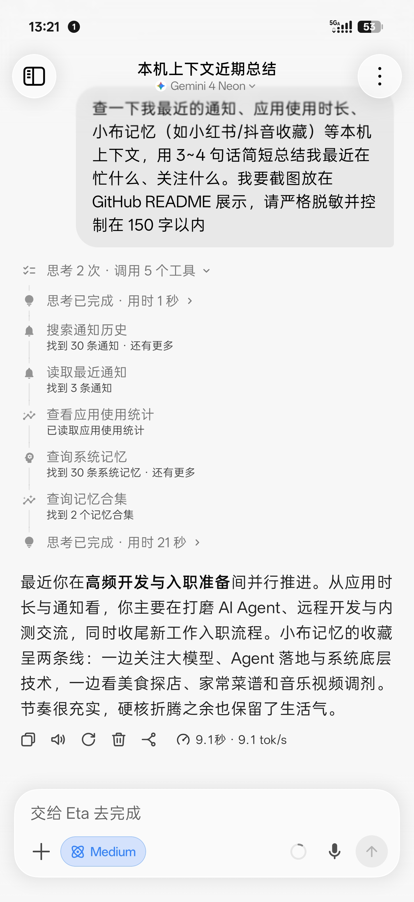
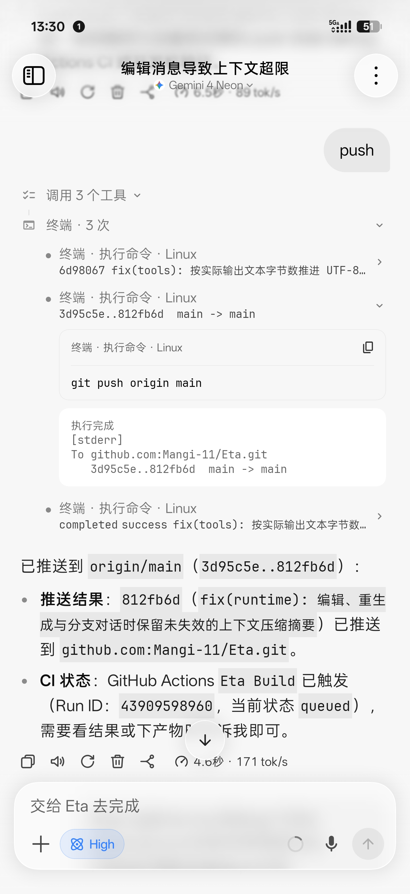
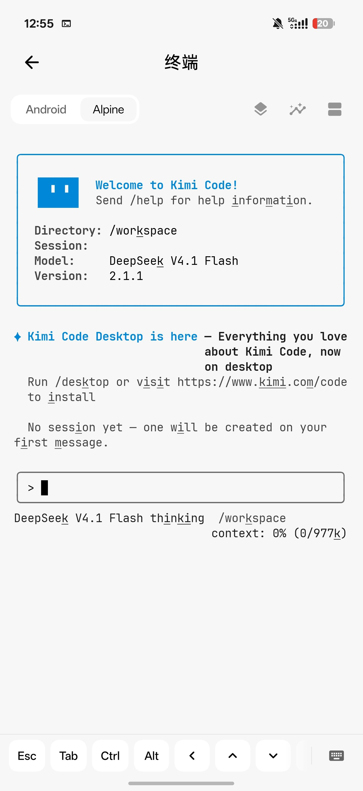
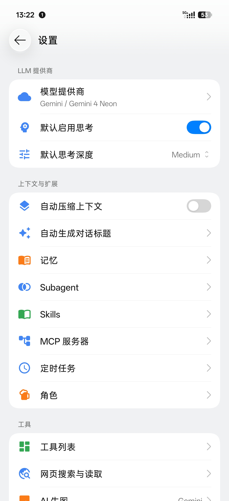
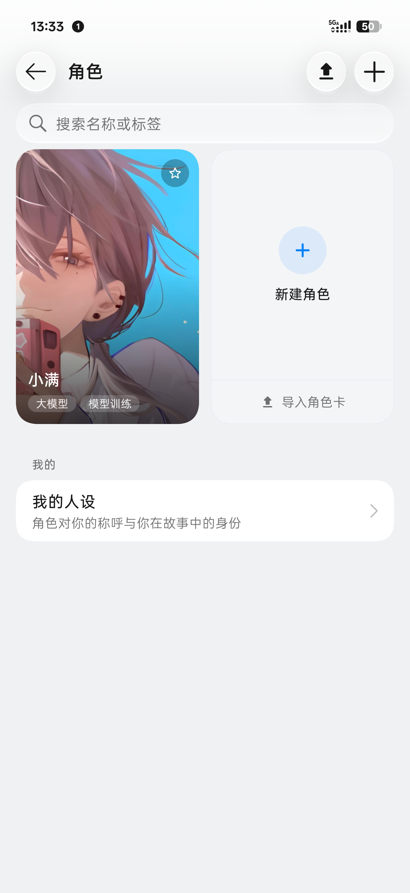

# EtaX

[简体中文](README.md) | **English**

> This repository is [icexxl/EtaX](https://github.com/icexxl/EtaX) (`applicationId: io.github.icexxl.etax`), a customized fork of [Mangi-11/Eta](https://github.com/Mangi-11/Eta) that can install alongside upstream. While preserving upstream capabilities and attribution under GPL-3.0, EtaX adds an **OpenClaw remote channel (SSE + FCM push wake-up)**, a **rootless background virtual display (Stellar)**, and a modular codebase. Upstream is tracked read-only; no PRs, issues, or patches are sent upstream from this fork.

**A system-level AI assistant and mobile agent for Android in the LLM era.**

**EtaX** is an AI agent built for phones and mobile devices, combining the autonomous planning and execution of coding agents like [Codex](https://openai.com/codex/) with the cross-app GUI experience of [Doubao Phone Assistant](https://o.doubao.com/).

## EtaX Fork Highlights

- **OpenClaw Remote Agent Channel (`:openclaw-core`)**:
  - Native integration with self-hosted OpenClaw Gateways, featuring a dedicated sidebar session panel, three-segment top bar, live streaming reasoning/tool-call rendering (`StreamingMarkdown`), and smooth bottom-follow scrolling.
  - Single-connection **SSE** live event stream with `ETag`/`304` caching, automatic long-poll fallback, and network-change reconnect (`OpenClawNetworkMonitor`).
  - **Firebase Cloud Messaging (FCM) push wake-up** and a background sleep power-saving toggle: receive high-priority notifications even when the app is suspended or screen-off (place your own `app/google-services.json` when building locally; the plugin is skipped cleanly if absent).
- **Rootless Background Virtual Display (`:vscreen-core` + `:stellar-api`)**:
  - Backed by **Stellar** (Shizuku-compatible privileged user service) running under `shell` permissions to operate a silent background virtual display **without Root**, complete with live top-capsule miniature preview and one-tap handoff to the main screen.
  - System prompts dynamically reflect rootless / Root / LSPosed virtual display availability and actual device tool boundaries.
- **Modular Structure & Unified Branding**:
  - Core app sources retain the upstream `io.github.mangi.eta` namespace to ease upstream syncs while decoupling OpenClaw and virtual display into standalone Gradle modules; package ID (`io.github.icexxl.etax`), default prompt (with lossless migration), and user-facing strings are unified as **EtaX**.

## Overview

Benchmarked against built-in OEM system assistants, EtaX integrates deeply with Android system services, OEM ROMs, and on-device data—**aiming to deliver a true AI phone experience for the LLM era**:

- **Comprehensive personal context**: taps directly into system data, OEM data, and **Xiaobu Memory** (including saved Xiaohongshu, Douyin, and Bilibili posts & video summaries) to retrieve notifications, SMS & OTPs, calls, photos (text & visual search), recording summaries, notes, health data, clipboard, chat images, bills, itineraries, delivery orders, and more.
- **Native system & first-party actions**: calls Android APIs and native first-party interfaces to manage calendar events, alarms, timers, system notes, and device controls, while running cross-app tasks silently on a background **virtual display** (via rootless Stellar, Root, or LSPosed).
- **Native digital assistant & system entry points**: set EtaX as Android's default digital assistant to wake it with screen context from the power button, with Android 16+ Live Updates / Fluid Cloud, plus power-button routing (EtaX or Gemini) and Google Circle to Search on compatible ROMs.
- **Full Agent Runtime & extensions**: implements its own Agent Runtime and Agent Loop, with parallel Subagents, scheduled tasks, a mobile PTY terminal & Linux environment, AI image generation, long-term memory, Skills, MCP, Tavern character companionship, and **OpenClaw remote channel**.

Bring your own **API key (BYOK)** or sign in with a **Codex (ChatGPT) / Grok subscription**—you choose the model. Requires **Android 14+** across phone brands, with core features available without root; **Stellar** unlocks the rootless background virtual display, while Root and LSPosed further unlock deep personal context and ROM entry points.

[Download APK](https://github.com/icexxl/EtaX/releases) · [Fork Highlights](#etax-fork-highlights) · [Use Cases](#what-you-can-ask-etax) · [Capabilities](#core-capabilities) · [Permissions](#permissions--device-support) · [Getting Started](#getting-started) · [Why Eta Was Built](docs/WHY_ETA_EN.md)

## What You Can Ask EtaX

- **Power-button screen Q&A & in-place actions** — *Long-press the power button to ask directly about what's on screen, or have EtaX fill out forms, write and submit delivery reviews, and handle other tasks right in the current app.*
- **Chat with your self-hosted OpenClaw** — *Talk to your home/server OpenClaw agent in real time with live reasoning and tool traces, and get woken up via FCM push when long-running tasks finish in the background.*
- **On-device Android tinkering & Magisk modules** — *"Inspect my phone's current system properties and config files, write a Magisk module tailored to this device, package it, and flash it directly."*
- **Device troubleshooting & live debugging** — *Hit a weird phone issue like battery drain, missing notifications, permission conflicts, or an app crash? Have EtaX inspect system state, pull recent logcat logs, or analyze the APK to pinpoint and resolve it.*
- **Vibe Coding right on your phone** — *Write code, build projects, clone repos, and run tests anywhere using a full Linux environment and Android shell, or run Claude Code and Codex in the touch PTY terminal.*
- **Tap into Xiaobu Memory & personal data** — *"Pull my saved Xiaohongshu guides, Douyin video summaries, bills, and flight orders from Xiaobu Memory, build next week's itinerary into my calendar, and set an alarm for departure morning."*
- **Run cross-app tasks quietly in the background (Rootless-capable)** — *"Open my airline app, find seat selection, and pick a window seat while I keep watching my video; hand it over at the confirmation screen."*
- **Scheduled briefings & parallel research** — *"Every morning at 8 AM, compile yesterday's notifications and today's schedule and alert me on changes—or spin up multiple Subagents to research in parallel."*
- **Emotional companionship & character roleplay** — *Create your own character or import SillyTavern cards with worldbooks and isolated story memory; backed by your phone's personal context, your companion understands your daily life and can check your schedule, set alarms, or operate apps directly.*

## See It in Action

| Native Power-Button Wake | Background Virtual Display | Live Virtual Display Preview & Takeover |
| :---: | :---: | :---: |
|  |  |  |

| Comprehensive Personal Context | Mobile Vibe Coding | Touch PTY Terminal |
| :---: | :---: | :---: |
|  |  |  |

| Settings | Breeno Takeover (Legacy) | Characters & Companionship |
| :---: | :---: | :---: |
|  |  |  |

## Core Capabilities

### System-Level Assistant & Personal Context

- **Comprehensive Personal Context**: Retrieves notification history, calendar, location, SMS & OTPs, contacts, call logs, photos (OCR text & visual search), recordings, clipboard, health summaries, and chat images. On ColorOS, EtaX also connects directly to **Xiaobu Memory** and **ColorOS Aggregated Search Service (DMP)**—opening up your saved Xiaohongshu / Douyin / Bilibili posts and video summaries, voice notes, memory collections, bills, itineraries, delivery orders, notes, recording summaries, and saved places to any model you choose.
- **Native System & 1st-Party Actions**: Calls Android and first-party app APIs directly to manage calendars, alarms, timers, system notes, and device controls (brightness, volume, DND, flashlight, Wi-Fi, Bluetooth, hotspot, NFC, app freezing, etc.).
- **Native Digital Assistant & Entry Points**: Set EtaX as Android's default digital assistant for power-button wake with screen context; supports Android 16+ Live Updates / Fluid Cloud / Super Island, hold-to-talk ASR (Qwen / Doubao / MiMo / DeepSeek), and multi-engine TTS; compatible ROMs add power-button routing (EtaX, Gemini, or OEM default, with automatic default-assistant syncing) and Google Circle to Search (handle long press / two-finger press).
- **GUI & Background Virtual Display**: Combines accessibility and lossless screenshots for cross-app control; operates in place on the main screen, or defaults to a silent background virtual display with **Stellar (rootless)**, Root, or LSPosed, with a live miniature preview in the top capsule for instant takeover or one-tap handoff to the main screen.

### Autonomous Orchestration & Mobile Toolbox

- **OpenClaw Remote Channel**: Streams live assistant output, reasoning traces, and tool steps over SSE with ETag caching, network-change recovery, and FCM background sleep wake-up for low latency and low battery usage.
- **Parallel Subagents**: Runs multiple isolated Subagents concurrently (built-in `explore`, `coder`, `plan`, plus custom templates), with optional lighter Secondary Model selection and live step inspection in chat.
- **Scheduled Tasks**: Supports one-time, recurring, and Cron background execution with change-only alerts or silent archiving—creatable and manageable directly in conversation.
- **Mobile Terminal, Linux & Vibe Coding**: Delivers full desktop-grade Coding Agent capabilities—file editing, search, and shell execution—backed by a complete Alpine / Debian Linux environment (rootless PRoot or root chroot), plus a mobile touch PTY console capable of running TUIs such as Claude Code and Codex alongside background daemons and file management.
- **Web Browser & AI Image Generation**: Web search plus a takeover-ready built-in browser; native text-to-image and image editing across 6 providers (Gemini, OpenAI, xAI, Doubao, Qwen, SiliconFlow) with chat cards and a gallery.

### Models, Extensions & Daily UX

- **Model Ecosystem**: Supports OpenAI (Chat Completions / Responses), Anthropic, and Gemini (including Google Cloud Vertex AI) protocols; includes 12 built-in providers, custom endpoints, `models.dev` catalog import, and **Codex (ChatGPT) / Grok subscription sign-in**.
- **Emotional Companionship & Tavern Ecosystem**: Create custom characters and stay compatible with the SillyTavern ecosystem—supporting PNG / JSON character card import & export, user personas, embedded worldbooks, isolated story memory, and in-place editing/regeneration—while still accessing your phone's personal context and tools.
- **Memory & Extensions**: Local `MEMORY.md` long-term memory, Skills from GitHub or ZIP, and remote Streamable HTTP MCP tools.
- **Native Polish**: Mid-run queuing and steering, conversation branching, native LaTeX math rendering, **Miuix / COUI** dual native UI styles, and English / Simplified / Traditional Chinese UI.

## Permissions & Device Support

- **Standard Device (No Root)**: Full chat & models, OpenClaw remote channel (SSE + FCM push), emotional companionship & Tavern character cards, AI image gen, Subagents, scheduled tasks, memory / Skills / MCP, web & browser, standard terminal & PRoot Linux, calendar / notifications / location / app usage, main-screen GUI, and EtaX native digital assistant.
- **No Root + Stellar (Privileged Service)**: Unlocks the **background virtual display** for silent cross-app GUI automation and live miniature preview without rooting.
- **Rooted Device**: Background virtual display, system controls & native 1st-party actions (alarm management / notes), app management, deep personal context (SMS / calls / photo content search / health / chat images), and root shell & chroot.
- **LSPosed + Compatible ROM**: Background virtual display, ColorOS / HyperOS power-button routing (EtaX or Gemini), direct Xiaobu Memory access, and Google Circle to Search (handle long press / two-finger press).

See [Device Support & Permissions](docs/ROOTLESS_SUPPORT.md) for full details.

## Getting Started

1. Download and install the APK from [Releases](https://github.com/icexxl/EtaX/releases) (or build locally with `./gradlew :app:assembleRelease`), then open **Model providers** to configure an API key (or sign in with Codex / Grok) and add a model.
2. Open **Permissions** to grant the permissions you need, and enable autostart and lock EtaX in Recents in your system settings.
3. *(Optional, Rootless Virtual Display)* Install and start **Stellar** and authorize EtaX to enable the background virtual display without Root.
4. *(Optional, OpenClaw)* Configure your Gateway URL and token under **Settings → OpenClaw** to enable SSE streaming and FCM push wake-up (place your own `app/google-services.json` when building locally).
5. *(Optional)* Open **Linux tool environment** to install a Linux distribution and common tools; on Root / LSPosed devices, activate the module in LSPosed Manager, select the required scopes, and reboot.

> **Privacy note**: Task context, images, and tool outputs are sent to your configured model provider. Raw results from sensitive and MCP tools are excluded from local chat history, and conversations support Markdown export and full backup/restore.

## Documentation

*(Implementation docs below are in Chinese unless noted otherwise.)*

- [Why Eta Was Built](docs/WHY_ETA_EN.md) — Upstream motivation, mobile AI ecosystem observations, and Agentic OS vision *(English)*
- [Device Support & Permissions](docs/ROOTLESS_SUPPORT.md) — Rootless / Root / LSPosed scope and background limits
- [Technical Implementation](docs/TECHNICAL.md) — Device tools, personal data retrieval, browser, terminal, and system integration
- [Agent Runtime](docs/AGENT_RUNTIME.md) — Agent loop, providers, steering, file tools, and recovery
- [Voice Setup](docs/VOICE.md) — Online speech recognition and synthesis configuration
- [Characters](docs/CHARACTERS.md) — Tavern card compatibility, worldbooks, and story memory
- [HyperOS System Entry](docs/HYPEROS_SYSTEM_ENTRY.md) — Power-button routing and Circle to Search on HyperOS
- [Native Terminal Components](docs/TERMINAL_NATIVE.md) — Building bundled PTY and PRoot components

## References and Acknowledgements

- [Eta (Mangi-11/Eta)](https://github.com/Mangi-11/Eta): upstream open-source baseline for the core Agent Runtime, system integrations, and UI.
- [Pi Coding Agent](https://github.com/earendil-works/pi): main reference for the agent runtime, including the agent loop, tool calling, steering, and transcript state management.
- [OmniBot](https://github.com/omnimind-ai/OmniBot): reference project for AI agents on Android.
- [libxposed API](https://github.com/libxposed/api): modern Xposed API.
- [Miuix](https://github.com/compose-miuix-ui/miuix) and [COUI](https://github.com/suqi8/coui): UI component libraries.

## License

Copyright © 2026 [蛮吉 (Mangi-11)](https://github.com/Mangi-11) & [icexxl](https://github.com/icexxl) (EtaX fork)

This project is open source under GPL-3.0; see [LICENSE](LICENSE) for details.
